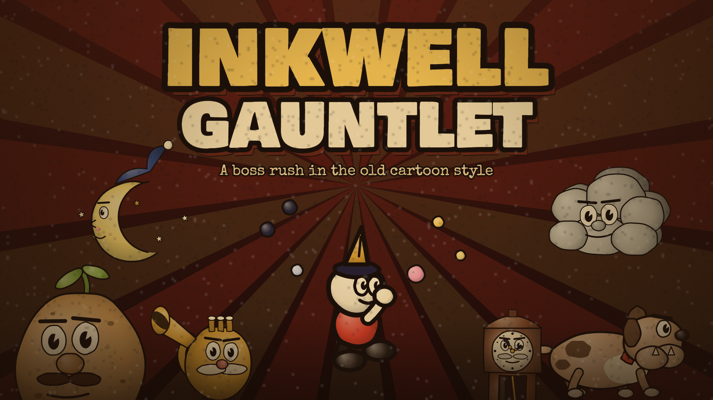

# Inkwell Gauntlet

A boss-rush game in the style of 1930s rubber-hose cartoons. It runs in the browser and is one HTML file with no installs.

## Play

**[Play it in your browser](https://cillx111.github.io/inkwell-gauntlet/)**, or download `index.html` and open it in any modern browser. Progress saves in that browser.

## The bosses

1. Sir Spudsworth (on foot)
2. Big Band Tubbs (on foot)
3. Grandpa Tock (on foot)
4. Butch the Bulldog (on foot)
5. Cumulo Grumbus (in the air)
6. Lady Lunetta (in the air)
7. Jolly Jack (on foot)
8. Admiral Blimpwick (in the air)
9. King Smudge, the final boss of World 1 (on foot)

### World 2

World 2 is hidden. Beat all nine World 1 bosses, then scroll down on the title screen or the map to find it.

1. Sid Sidewinder, a rattlesnake who chases you while you run and shoot backwards (on foot)
2. Sir Waxley, a candle knight who can blow out the lights (on foot)
3. The Great Gramophone (in the air)
4. Mama Matryoshka, who gets smaller and faster every phase (on foot)
5. The Projectionist, the World 2 finale (in the air)

### World 3

World 3 is plane fights only. Beat all of World 2, then scroll down on the map again.

1. Wriggles the Sky Wyrm, a giant segmented worm that weaves around the screen
2. Lanterna the Deep, an anglerfish fought while the cave scrolls down and then up
3. The Cogitator, a machine brain you fight while flying through a scrolling maze
4. Pyrella the Phoenix, who traps you in a shrinking ring of fire
5. The Ink Eternal, the World 3 finale, with SURVIVE phases where it is shielded

The World 3 bosses drop five extra weapons, which the shop also sells: the Storm Staff (fast lightning bolts), the Boomer Blade (a thrown blade that comes back), the Starfall Tome (stars that fall onto the boss), the Ink Flamer (a short-range flamethrower) and the Wisp Lantern (wisps that circle you, then dive at the boss).

Every boss has several phases, ending in a last stand at 5% health. Beat bosses to earn coins, buy new shots and charms in the shop, and pick your loadout under Equip. Expert mode makes bullets faster and bosses tougher.

## Controls

| Action | Keys |
| --- | --- |
| Move | Arrows / WASD |
| Jump (again in mid-air: double jump + parry) | Z / Space / J |
| Shoot (hold) | X / K |
| Dash (invincible while dashing) | C / L / Left Shift |
| EX shot | V / I |
| Plant feet | F / Q |
| Swap weapon | E / Tab |
| Pause | Esc / P |

Gamepads and touch controls work too. Pink things can be parried: jump into them and press jump again.

There are 23 easter eggs to find, plus a secret weapon somewhere on the title screen.
